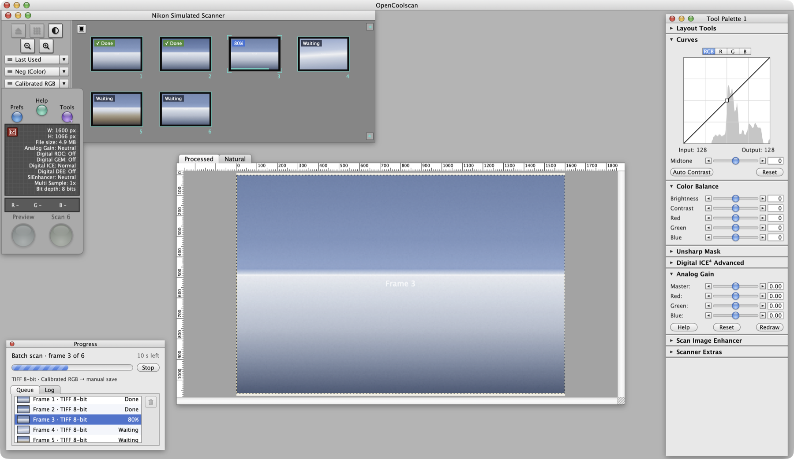

# OpenCoolscan

An open-source macOS scanning app for **Nikon Coolscan** film scanners, with the look and workflow of the classic Nikon Scan 4 on Mac OS X — rebuilt in SwiftUI for Apple Silicon and Intel Macs.



> OpenCoolscan is an independent project and is not affiliated with, endorsed by, or sponsored by Nikon Corporation. Nikon, Coolscan and Digital ICE are trademarks of their respective owners.

## Features

- **Classic Nikon Scan 4 workspace** – scanner window with frame thumbnails, info drawer, Preview/Scan buttons, image window with rulers, Progress window and Tool Palette. All panels float freely inside the app window and remember their positions.
- **Batch scanning** – select several frames and scan them in one go; per-frame status (Done / % / Waiting), queue, log and time remaining.
- **Layout Tools** – rotate (90°/180°) and mirror frames, per frame or for the whole strip. Orientation is applied to previews, thumbnails and saved files.
- **Tool Palette** – Curves (with histogram and Auto Contrast), Color Balance, Unsharp Mask, Digital ICE⁴ options (ICE, ROC/GEM-style post processing, DEE-style shadow recovery), per-channel Analog Gain, Scan Image Enhancer and Scanner Extras (bit depth, multi-sample, strip film offset).
- **Crop** – draw a marquee on the preview; the scanner crops in hardware, also when the preview is rotated.
- **Film presets**, 8/16-bit scanning, TIFF/JPEG/PNG output, batch save and optional auto-save.
- **Simulated scanner** for trying the app without hardware.

## Supported scanners

Coolscan LS-30, LS-40, LS-50, LS-2000, LS-4000, LS-5000, LS-8000 and LS-9000, via the SANE `coolscan3` backend.

## Requirements

- macOS 13 Ventura or later
- [SANE](http://www.sane-project.org/) for real hardware:
  ```bash
  brew install sane-backends
  ```

## Install

Download `OpenCoolscan.zip` from the [latest release](../../releases/latest), unzip it and move `OpenCoolscan.app` to Applications.

The app is not notarized, so the first time macOS will refuse to open it. Right-click the app and choose **Open**, or run:

```bash
xattr -dr com.apple.quarantine /Applications/OpenCoolscan.app
```

## Architecture

The scanner core — USB detection, SANE/`coolscan3` preview and scanning, settings and image processing — lives in the [CoolscanKit](https://github.com/EDalhus/CoolscanKit) Swift package. OpenCoolscan pins CoolscanKit to an exact version and contains only the Nikon Scan 4–style interface.

## Build from source

```bash
./build.sh
open OpenCoolscan.app
```

Or with SwiftPM directly:

```bash
swift build -c release
.build/release/OpenCoolscan
```

## Getting started

1. Click the scanner window's title ("No Scanner — click to select") and pick your Coolscan, or **Simulated Scanner**.
2. Press the thumbnails button (▦) to preview all frames on the strip.
3. Select frames (⌘-click / ⇧-click), adjust in the Tool Palette, and press **Scan**.
4. Save with **File ▸ Save Scan…** or **Batch Save Frames…**.

Resolution, auto focus and save format live in the **Scanner** and **File** menus. **Tools ▸ Reset Window Layout** puts all panels back in place.
